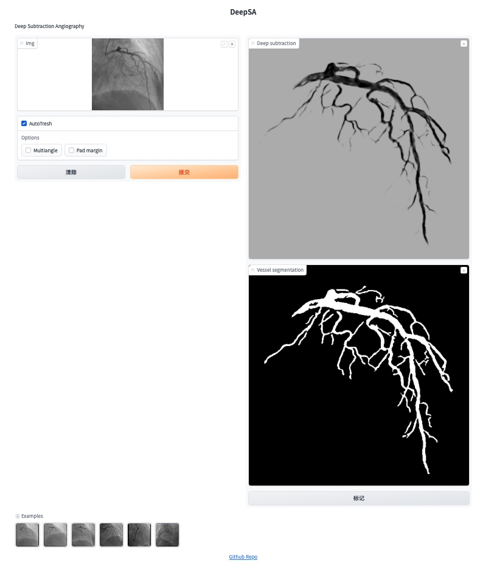

# Cardiology Coronary Artery Image Processing
## Overview
Pretrained Subtraction and Segmentation Model for Coronary Angiograms

## Online demo
http://116.63.137.34:7860


## Install
```shell
pip install -r requirements.txt
```


## Dataset
- LM-CAD (Live-Mask Coronary Angiogram Dataset): [google driver](https://drive.google.com/drive/folders/1fEKPNMcRv5qb8vKyaJzF1P9V9ZavA1xL)
- FS-CAD (Fine Segmentation Coronary Angiogram Dataset): [google driver](https://drive.google.com/drive/folders/1fEKPNMcRv5qb8vKyaJzF1P9V9ZavA1xL)

Create a "datasets" folder in the root directory, and then extract the dataset and place it in the folder.

## Train
Train pretrained model use LM-CAD dataset
```shell
python train.py --name xxxx
```

## Finetune
Finetune pretrained mode use FM-CAD dataset
```
python finetune.py --name xxxx
```

## Run demo
```
python demo.py
```

## Real-time coronary pipeline (<= 36 ms/frame)

The original DeepSA subtraction model is unchanged and still available; it needs
**4 078 ms per frame on CPU** (113x the budget), because a single
`UNet(1, 1, 32, bilinear=True)` forward pass at 512x512 costs 850-1200 ms on
this machine.  A real-time path was therefore added next to it, as a separate
module that does not touch `demo.py::predict`, `utils.py` or `models.py`.

```
realtime.py      CoronaryRealtimePipeline - the <= 36 ms OpenCV/NumPy pipeline
latency.py       StageTimer / LatencyMeter / LatencyReport, hardware info, host load
benchmark.py     latency benchmark CLI (avg / min / max / FPS / hardware)
evaluate_quality.py  ground-truth quality metrics
make_synthetic_dataset.py  synthetic coronary phantom generator + masks
```

### Stages

| # | Stage | What it does | Mean (ms) |
| --- | --- | --- | --- |
| 1 | ingest | bit-depth-safe normalisation; 8, 16, float and RGB(A) input, the window is taken from percentiles of a subsample so 16-bit cine frames keep their contrast | 0.95 |
| 2 | preprocess | 3x3 median denoise + CLAHE (8x8 tiles, clip 2.5) | 1.34 |
| 3 | background suppression | three background estimates fused in a small analysis domain: fine scale (ribs, thin bands), coarse scale (spine, lung fields, diaphragm) and an **oriented line background** - a morphological opening with a long line element over 0/45/90/135 degrees, which only preserves a structure containing a straight segment of that length, so a rib is absorbed while a curved coronary branch is not | 2.34 |
| 4 | vessel enhancement | multi-scale Frangi ridge filter (Hessian eigenvalues via three identities instead of a sort, per-scale normalisation from the image statistics) on the background-subtracted residual, evaluated at 192x192 and resampled | 4.35 |
| 5 | rib / vessel cleanup | threshold, small morphological close, connected components, area filter and a second-moment rib test (long + thin + straight) | 1.74 |
| 6 | output | background-suppressed frame, coronary-enhanced frame (histogram-stretch LUT composed with the gamma LUT, so one lookup per image), vessel mask, optional 16-bit enhanced output, and the `original \| background suppressed \| coronary enhanced` comparison strip, reduced by an integer factor so OpenCV takes the fast box path of `INTER_AREA` and with a pre-rasterised label bar | 4.23 |

All outputs for one frame: `raw`, `processed`, `enhanced`, `segmentation`,
`comparison`, `enhanced_16bit` (for 16-bit input), plus `latency_ms`,
`stages_ms` and `metrics`.  Input bit depth is preserved: a 16-bit frame is
windowed to 8 bit for processing and the enhanced result is returned as 16-bit
`I;16` again.

### Measured latency

`python benchmark.py --input example --frames 400 --report latency_report.md --json latency_report.json`

| Metric | Value |
| --- | --- |
| Frames measured | 400 (512x512) |
| **Average latency** | **16.59 ms** |
| **Minimum latency** | **11.12 ms** |
| **Maximum latency** | **33.19 ms** |
| Median / P95 / P99 | 16.16 / 21.22 / 25.15 ms |
| Std deviation | 2.77 ms |
| **Throughput** | **60.3 FPS** |
| Budget | 36 ms |
| Frames over budget | **0** |
| Host CPU load during the run | 30 % |
| Reference: original `predict()` | 4 078 ms/frame (0.25 FPS) |

The number the report is sensitive to is external CPU load, not the pipeline:
all six stages scale together, so on an otherwise idle machine the average
drops to about 13 ms. `benchmark.py` samples host load and writes it next to the
timings for exactly this reason, and `latency.py` reports process CPU time
separately from wall clock.

**Hardware / software configuration**

- CPU: 11th Gen Intel(R) Core(TM) i5-1155G7 @ 2.50GHz, 8 logical cores
- RAM: 7.8 GB
- Platform: Windows 10 (AMD64), Python 3.11.4
- PyTorch 2.5.1+cpu, 4 threads, CUDA not available
- OpenCV 4.10.0, 8 threads, NumPy 1.26.4
- The machine is shared, so a run at ~50% external load can show a few frames
  over budget even though the pipeline itself is unchanged; re-run to confirm.

Latency is wall-clock from "frame handed in" to "every output image rendered",
measured with `time.perf_counter` after a warm-up, and it includes the
comparison strip and the 16-bit output.  The pipeline is also warmed up in its
constructor so the first interactive frame is already inside the budget.

### Quality on ground-truth data

A synthetic coronary phantom with known masks (coronary tree, ribs, spine, lung
fields, plus noise, vignetting, illumination gradient and cardiac motion) makes
the suppression measurable:

```
python make_synthetic_dataset.py --frames 40 --seed 11 --motion 0.6
python evaluate_quality.py --input datasets/synthetic
```

40 frames, levels relative to the vessel tree (1.0 = as bright as the vessels,
0.0 = removed):

| Structure | raw | background suppressed | enhanced |
| --- | --- | --- | --- |
| coronary tree | 1.00 | 0.60 | 0.67 |
| ribs | 0.66 | 0.36 | 0.23 |
| spine | 0.24 | 0.01 | -0.08 |
| lung fields | 0.27 | -0.09 | 0.06 |

- contrast-to-noise ratio inside the vessel mask: **4.09 -> 6.29 (1.54x)**
- vessel signal surviving background subtraction: 144 intensity levels
- vessel mask quality: precision 0.10, recall 0.22, F1 0.13 - the mask is
  deliberately conservative (it is only a by-product of the enhancement gain),
  and the enhanced frame, not the binary mask, is the output meant to be read.

### Use

```shell
# interactive demo: pick the engine in the UI (real-time is the default)
python demo.py

# latency benchmark
python benchmark.py --input example --frames 400 --report latency_report.md
python benchmark.py --input datasets/synthetic/cine --frames 400 --strict

# single frame outputs (raw / processed / enhanced / mask / comparison / 16-bit)
python benchmark.py --input example/example1.png --frames 1 --save-dir out
```

`benchmark.py --strict` exits non-zero when a single frame exceeds the budget,
so it can be used as a regression check in CI.
